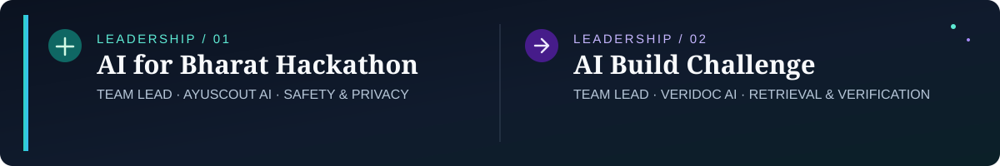
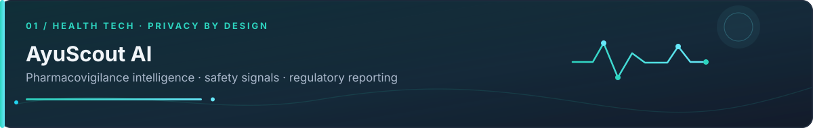
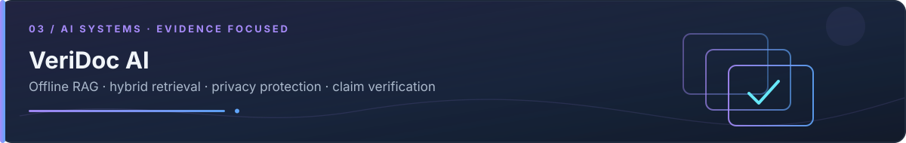
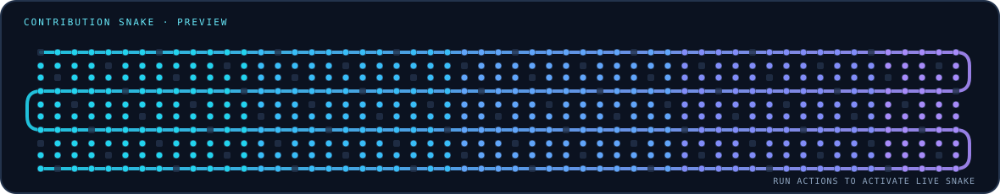

<!-- ARPIT JHAM | GitHub profile README
     Uses dark.svg and light.svg in the repository root.
     The contribution snake starts as a preview until the GitHub Actions workflow succeeds.
-->

  <picture>
    <source media="(prefers-color-scheme: dark)" srcset="https://raw.githubusercontent.com/Arpit248-3/Arpit248-3/main/dark.svg" />
    <source media="(prefers-color-scheme: light)" srcset="https://raw.githubusercontent.com/Arpit248-3/Arpit248-3/main/light.svg" />
    
  </picture>

  &nbsp;&nbsp;
  <a href="https://linkedin.com/in/arpit-jham-6963b628a">LinkedIn</a>&nbsp;&nbsp;&nbsp;&nbsp;
  &nbsp;&nbsp;
  <a href="https://leetcode.com/u/Arpit24Jh--8-3/">LeetCode</a>&nbsp;&nbsp;&nbsp;&nbsp;
  &nbsp;&nbsp;
  <a href="mailto:arpitjham23@gmail.com">Email</a>

---

## GitHub Developer Stats

  
   
  
  

---

I'm a Computer Science and Engineering student at **Dr. Ambedkar Institute of Technology, Bengaluru**, with a **CGPA of 8.3/10**. I work across frontend interfaces, backend APIs, databases, and applied AI to turn complex workflows into practical software.

My interests sit at the intersection of **reliable backend services**, **thoughtful UI/UX**, **privacy-aware data handling**, and **AI-assisted decision support**. I enjoy taking a problem from product framing and system design through implementation and a clear user-facing experience.

B.E. COMPUTER SCIENCE &amp; ENGINEERING &nbsp;·&nbsp; CGPA <strong>8.3/10</strong> &nbsp;·&nbsp; BENGALURU, INDIA

RECENT ACTIVITY &nbsp;·&nbsp; LAST 31 DAYS

ANNUAL CONTRIBUTION HEATMAP

 

### AI for Bharat Hackathon 2026 · Team Lead

**Project:** [AyuScout AI ↗](https://github.com/Arpit248-3/Pan-IIT)  
Led product development for a pharmacovigilance intelligence platform, bringing safety-signal review, patient-data protection, and regulatory reporting into one workflow.

<strong>FOCUS</strong> &nbsp; Safety signal review · Privacy by design · Regulatory reporting

---

### AI Build Challenge Bengaluru · Team Lead

**Project:** [VeriDoc AI ↗](https://github.com/Arpit248-3/hackingly)  
Led project direction for offline retrieval-augmented generation, hybrid retrieval, PII protection, and evidence-based claim verification.

<strong>FOCUS</strong> &nbsp; Offline RAG · Hybrid retrieval · Evidence verification

Full-stack toolkit · two-column engineering stack

<table width="100%">
<tr>
<td width="50%" valign="top">
<h3>01 · Programming &amp; Query</h3>

Python · C++ · JavaScript · SQL (MySQL)
</td>
<td width="50%" valign="top">
<h3>02 · Frontend &amp; UI</h3>

React · React Native · Vite · UI architecture · State management
</td>
</tr>
<tr>
<td width="50%" valign="top">
<h3>03 · Backend &amp; APIs</h3>

FastAPI · Django · Node.js · Express.js · REST APIs · Validation
</td>
<td width="50%" valign="top">
<h3>04 · Databases</h3>

MySQL · PostgreSQL · MongoDB · SQLite · Schema design · Data modeling
</td>
</tr>
<tr>
<td width="50%" valign="top">
<h3>05 · Tools &amp; Delivery</h3>

Git · GitHub · Vercel · VS Code · Anaconda · Deployment
</td>
<td width="50%" valign="top">
<h3>06 · AI &amp; Retrieval</h3>

<strong>Forecasting &amp; ML</strong> LSTM · Transformers · XGBoost

<strong>Retrieval &amp; verification</strong> RAG · BM25 · Dense retrieval · Evidence verification

</td>
</tr>
</table>

Selected engineering work · useful interfaces · reliable systems · evidence-first AI

A React dashboard for adverse-event review, safety alerts, KPIs, drug exploration, and report management, backed by FastAPI REST APIs.

- **Safety:** PII detection and patient-identity masking.
- **Data quality:** Drug-name normalization with fuzzy matching.
- **Reporting:** ICH E2B(R3) XML report exports.

**Explore:** [Source repository ↗](https://github.com/Arpit248-3/Pan-IIT) &nbsp;·&nbsp; [Live demo ↗](https://ayuscout-frontend.onrender.com/)

---

An early-warning concept for import-dependent energy supply chains, combining weather, shipping, commodity, energy-demand, and geopolitical signals.

- **Forecasts:** 24-hour, 3-day, 7-day, and 30-day horizons.
- **Models:** LSTM, Transformer, and XGBoost approaches.
- **Decision support:** Risk heatmaps, geospatial alerts, and scenario planning.

**Explore:** [Source repository ↗](https://github.com/Arpit248-3/ET2)

---

An offline RAG and claim-verification project built around hybrid BM25 and dense retrieval, PII protection, and evidence-grounded answers for workflows where traceability matters.

<strong>CAPABILITIES</strong> &nbsp; Offline retrieval · Hybrid search · Privacy protection · Evidence verification

**Explore:** [Source repository ↗](https://github.com/Arpit248-3/hackingly)

More work: <a href="https://github.com/Arpit248-3?tab=repositories">browse all public repositories ↗</a>

<table width="100%"><tr>
<td width="50%" valign="top">

<h3>AI for Bharat Hackathon 2026</h3>

<strong>Theme Winner · Patient Experience &amp; Safety Signals</strong>

Recognized with AyuScout AI; ranked <strong>Top 4 among 16,200+ registrations</strong>.

</td>
<td width="50%" valign="top">

<h3>AI Build Challenge Bengaluru</h3>

<strong>1st Runner-Up · Masters’ Union Ventures, powered by Hackingly</strong>

September 2026 · VeriDoc AI

</td>
</tr></table>

---

## Contribution Snake

<!-- After the workflow succeeds and the output branch contains both SVGs, replace the preview above with this live block:

  <picture>
    <source media="(prefers-color-scheme: dark)" srcset="https://raw.githubusercontent.com/Arpit248-3/Arpit248-3/output/github-snake-dark.svg" />
    <source media="(prefers-color-scheme: light)" srcset="https://raw.githubusercontent.com/Arpit248-3/Arpit248-3/output/github-snake.svg" />
    
  </picture>

-->

---

## Connect

  &nbsp;
  <a href="https://linkedin.com/in/arpit-jham-6963b628a">LinkedIn</a>
  &nbsp;&nbsp;·&nbsp;&nbsp;
  &nbsp;
  <a href="https://leetcode.com/u/Arpit24Jh--8-3/">LeetCode</a>
  &nbsp;&nbsp;·&nbsp;&nbsp;
  &nbsp;
  <a href="mailto:arpitjham23@gmail.com">Email</a>

Focused on useful interfaces, reliable systems, privacy-aware AI, and products built to solve real problems.

