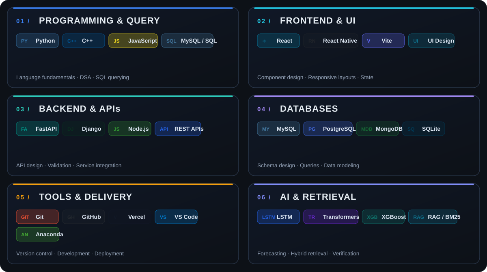

<!-- ARPIT JHAM | GitHub profile README
     Uses dark.svg and light.svg in the repository root.
     The contribution snake uses the output-branch SVGs generated by .github/workflows/snake.yml.
-->

  <picture>
    <source media="(prefers-color-scheme: dark)" srcset="https://raw.githubusercontent.com/Arpit248-3/Arpit248-3/main/dark.svg" />
    <source media="(prefers-color-scheme: light)" srcset="https://raw.githubusercontent.com/Arpit248-3/Arpit248-3/main/light.svg" />
    
  </picture>

<a href="https://linkedin.com/in/arpit-jham-6963b628a"> LinkedIn</a>&nbsp;&nbsp;·&nbsp;&nbsp;<a href="https://leetcode.com/u/Arpit24Jh--8-3/"> LeetCode</a>&nbsp;&nbsp;·&nbsp;&nbsp;<a href="mailto:arpitjham23@gmail.com"> Email</a>

---

## GitHub Developer Stats

 

---

I'm a Computer Science and Engineering student at **Dr. Ambedkar Institute of Technology, Bengaluru**, with a **CGPA of 8.3/10**. I work across frontend interfaces, backend APIs, databases, and applied AI to turn complex workflows into practical software.

My interests sit at the intersection of **reliable backend services**, **thoughtful UI/UX**, **privacy-aware data handling**, and **AI-assisted decision support**. I enjoy taking a problem from product framing and system design through implementation and a clear user-facing experience.

RECENT ACTIVITY · LAST 31 DAYS

ANNUAL CONTRIBUTION HEATMAP

<a href="https://github.com/Arpit248-3/Pan-IIT"> AyuScout AI repository</a>

Full-stack toolkit · two-column engineering stack

Selected engineering work · useful interfaces · reliable systems · evidence-first AI

A React dashboard for adverse-event review, safety alerts, KPIs, drug exploration, and report management, backed by FastAPI REST APIs.

- **Safety:** PII detection and patient-identity masking.
- **Data quality:** Drug-name normalization with fuzzy matching.
- **Reporting:** ICH E2B(R3) XML report exports.

<a href="https://github.com/Arpit248-3/Pan-IIT"> AyuScout AI repository</a>

---

An early-warning concept for import-dependent energy supply chains, combining weather, shipping, commodity, energy-demand, and geopolitical signals.

- **Forecasts:** 24-hour, 3-day, 7-day, and 30-day horizons.
- **Models:** LSTM, Transformer, and XGBoost approaches.
- **Decision support:** Risk heatmaps, geospatial alerts, and scenario planning.

<a href="https://github.com/Arpit248-3/ET2"> UrjaNetra AI repository</a>

---

An offline RAG and claim-verification project built around hybrid BM25 and dense retrieval, PII protection, and evidence-grounded answers for workflows where traceability matters.

<strong>CAPABILITIES</strong> &nbsp; Offline retrieval · Hybrid search · Privacy protection · Evidence verification

<a href="https://github.com/Arpit248-3/hackingly"> VeriDoc AI repository</a>

More work: <a href="https://github.com/Arpit248-3?tab=repositories"> Browse all public repositories</a>

<table width="100%">
  <tr>
    <td width="50%" valign="top"></td>
    <td width="50%" valign="top"></td>
  </tr>
</table>

---

## Contribution Snake

<picture><source media="(prefers-color-scheme: dark)" srcset="https://raw.githubusercontent.com/Arpit248-3/Arpit248-3/output/github-snake-dark.svg" /><source media="(prefers-color-scheme: light)" srcset="https://raw.githubusercontent.com/Arpit248-3/Arpit248-3/output/github-snake.svg" /></picture>

---

## Connect

<a href="https://linkedin.com/in/arpit-jham-6963b628a"> LinkedIn</a>&nbsp;&nbsp;·&nbsp;&nbsp;<a href="https://leetcode.com/u/Arpit24Jh--8-3/"> LeetCode</a>&nbsp;&nbsp;·&nbsp;&nbsp;<a href="mailto:arpitjham23@gmail.com"> Email</a>

Focused on useful interfaces, reliable systems, privacy-aware AI, and products built to solve real problems.
