<!--
  ARPIT JHAM | GitHub profile README
  Visual system: Midnight Navy · Electric Blue · Cyan · Teal · Violet · restrained Gold
  Animated local SVGs are generated by scripts/render_profile_visuals.py.
-->

  

  

<!-- Minimal icon-led links: no heavy rectangular badge row. -->

  <a href="https://linkedin.com/in/arpit-jham-6963b628a">&nbsp; LinkedIn</a>
  &nbsp; · &nbsp;
  <a href="https://leetcode.com/u/Arpit24Jh--8-3/">&nbsp; LeetCode</a>
  &nbsp; · &nbsp;
  <a href="https://github.com/Arpit248-3?tab=repositories">&nbsp; Projects</a>

  <a href="https://mail.google.com/mail/?view=cm&amp;fs=1&amp;to=arpitjham23%40gmail.com">&nbsp; <strong>Email: arpitjham23@gmail.com</strong></a>
  &nbsp; <a href="mailto:arpitjham23@gmail.com">(open default mail app)</a>

  
  
  

---

<h2 align="center"></h2>

I'm a Computer Science and Engineering student at **Dr. Ambedkar Institute of Technology, Bengaluru**, with a **CGPA of 8.3/10**. I work across frontend interfaces, backend APIs, databases, and applied AI to turn complex workflows into practical software.

I’m especially interested in products where **useful interfaces, reliable services, privacy-aware data handling, and decision support** come together. My project work spans pharmacovigilance intelligence, energy-supply-chain risk monitoring, and evidence-based claim verification.

  
  
  

<h2 align="center"></h2>

<table>
  <tr>
    <td width="50%" valign="top">
      

      <h3>AI for Bharat Hackathon 2026 · AyuScout AI</h3>
      
Led project development for a pharmacovigilance intelligence platform, aligning safety-signal review, patient-data protection, and regulatory reporting into a unified workflow.

      
 

    </td>
    <td width="50%" valign="top">
      

      <h3>AI Build Challenge Bengaluru · VeriDoc AI</h3>
      
Led a project direction combining offline retrieval-augmented generation, hybrid retrieval, PII protection, and evidence-based claim verification.

      
 

    </td>
  </tr>
</table>

<h2 align="center"></h2>

A visual skills matrix — technologies grouped by how I build and deliver software.

<table>
  <tr>
    <td width="25%" valign="middle"><strong>⌘ Programming</strong></td>
    <td valign="middle">
      
       Python · C++ · JavaScript · SQL (MySQL)
    </td>
  </tr>
  <tr>
    <td valign="middle"><strong>◈ Frontend & UI</strong></td>
    <td valign="middle">
      
       React.js · React Native · Vite · UI Architecture · State Management
    </td>
  </tr>
  <tr>
    <td valign="middle"><strong>⚙ Backend & APIs</strong></td>
    <td valign="middle">
      
       FastAPI · Django · Node.js · Express.js · REST APIs
    </td>
  </tr>
  <tr>
    <td valign="middle"><strong>▤ Databases</strong></td>
    <td valign="middle">
      
       MySQL · PostgreSQL · MongoDB · SQLite
    </td>
  </tr>
  <tr>
    <td valign="middle"><strong>⌁ Tools & Delivery</strong></td>
    <td valign="middle">
      
       Git · GitHub · Vercel · VS Code · Anaconda
    </td>
  </tr>
</table>

<h2 align="center"></h2>

<table>
  <tr>
    <td width="50%" valign="top">
      

      <h3>🩺 AyuScout AI</h3>
      
<strong>Pharmacovigilance Intelligence Platform</strong>

      
Helps safety teams review adverse-event reports, investigate potential drug-safety concerns, and explore safety trends through a dashboard for alerts, KPIs, drug exploration, and report management.

      <ul>
        <li>PII detection and patient-identity masking</li>
        <li>Drug-name normalization with fuzzy matching</li>
        <li>ICH E2B(R3) XML report exports</li>
        <li>React dashboard · FastAPI REST APIs · SQLite persistence</li>
      </ul>
      
  

    </td>
    <td width="50%" valign="top">
      

      <h3>⚡ UrjaNetra AI</h3>
      
<strong>Energy Supply-Chain Decision Support</strong>

      
Combines weather, shipping, commodity, energy-demand, and geopolitical signals to surface early warnings for import-dependent energy supply chains.

      <ul>
        <li>Forecast horizons: 24 hours · 3 days · 7 days · 30 days</li>
        <li>LSTM · Transformer · XGBoost model approaches</li>
        <li>Geospatial maps, risk heatmaps, and live alerts</li>
        <li>Scenario planning for suppliers, routing, inventory, and procurement</li>
      </ul>
      
  

    </td>
  </tr>
  <tr>
    <td colspan="2" valign="top">
      

      <h3>🔎 VeriDoc AI</h3>
      
<strong>Offline RAG & Evidence-Based Claim Verification</strong>

      
Hackathon project led around offline retrieval-augmented generation, hybrid retrieval, PII protection, and evidence-grounded claim verification.

      
<a href="https://github.com/Arpit248-3?tab=repositories">Explore available project repositories ↗</a>

    </td>
  </tr>
</table>

  

<h2 align="center"></h2>

<table>
  <tr>
    <td width="33%" valign="top" align="center">
      
      <h3>AI for Bharat Hackathon 2026</h3>
      
Won the Patient Experience & Safety Signals theme with AyuScout AI.

    </td>
    <td width="33%" valign="top" align="center">
      
      <h3>16,200+ Registrations</h3>
      
Top 4 among 16,200+ registrations at AI for Bharat Hackathon 2026.

    </td>
    <td width="33%" valign="top" align="center">
      
      <h3>AI Build Challenge Bengaluru</h3>
      
1st Runner-Up · Masters’ Union Ventures, powered by Hackingly · September 2026.

    </td>
  </tr>
</table>

  

<h2 align="center"></h2>

Recent GitHub activity, rendered locally with a smooth curve and updated from the contribution snapshot.

  

<strong>Annual contribution heatmap</strong>

  

<table>
  <tr>
    <td width="50%" align="center" valign="top">
      
    </td>
    <td width="50%" align="center" valign="top">
      
    </td>
  </tr>
</table>

  <a href="https://mail.google.com/mail/?view=cm&amp;fs=1&amp;to=arpitjham23%40gmail.com"><strong>✉ Email Arpit Jham · arpitjham23@gmail.com</strong></a>
  &nbsp; · &nbsp;
  <a href="mailto:arpitjham23@gmail.com">Open in default mail app</a>

Built with care · Focused on reliable software, thoughtful interfaces, and measurable product impact.

